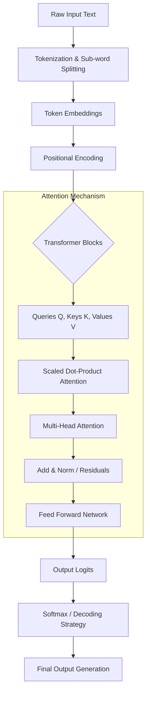
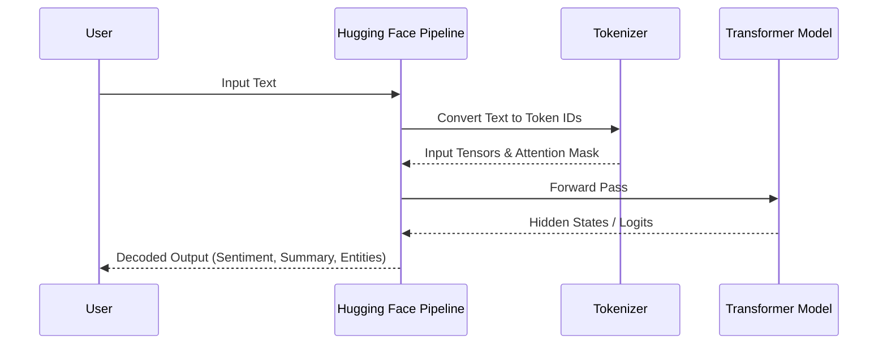

<div align="center">


<h1>NLP Pipelines with Transformers</h1>
<h3>From Scratch to Advanced Colab Implementations</h3>

<p><a href="https://github.com/alpha-cassius"></a> <a href="https://github.com/alpha-cassius?tab=repositories"></a> </p>

<p>AI &amp; ML | Python Developer | Robotics Enthusiast</p>

</div>

## 🌌 The mission: Decoding NLP with Transformers

Natural Language Processing (NLP) is how machines understand, generate, and manipulate human language. Before 2017, this was done using slow, sequential models like RNNs. Then, Google introduced the **Transformer** architecture in the seminal paper *"Attention Is All You Need"*[cite: 2].

Transformers changed everything by relying entirely on **Self-Attention mechanisms**[cite: 2]. Instead of reading a sentence word-by-word, a Transformer processes all tokens in parallel, calculating how strongly each word relates to every other word in the sequence[cite: 2, 4]. This enables:
*   **Massive Parallelization:** Training on modern GPUs is exceptionally fast[cite: 2, 17].
*   **Long-range Context:** It remembers connections across long documents without forgetting[cite: 2].
*   **Foundation for LLMs:** This exact architecture powers GPT, BERT, LLaMA, and Qwen[cite: 2].

I built this repository to demonstrate how to implement production-ready NLP pipelines from scratch using Google Colab, PyTorch, and Hugging Face.

### The Core Transformer Data Flow


## 🏗️ What I’m building

### Pipeline Execution Architecture



## ⚙️ Technology arsenal

## 🚀 How to run these pipelines

To run these models yourself, all you need is a browser.

1. Open [Google Colab](https://colab.research.google.com/).
2. Create a new notebook and run `!pip install -q transformers`.
3. Copy the code blocks from this repository into the cells.
4. Run the cells to dynamically download the model weights and execute the NLP tasks.

### Text Generation Pipeline Logic

```mermaid
graph LR
    A[Prompt: "The future is"] --> B(Tokenizer)
    B --> C[Model Inference]
    C --> D{Decoding Strategy}
    D -->|Greedy| E[Highest Probability Token]
    D -->|Top-K/Top-P| F[Sampled Token]
    E --> G[Append to Input]
    F --> G
    G -->|Repeat| C

```

